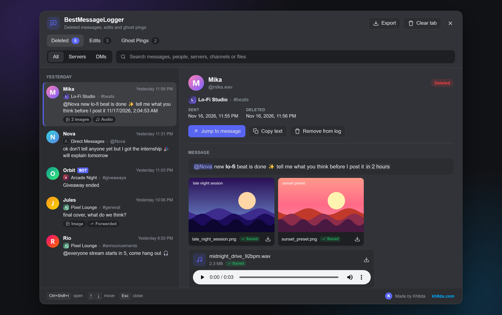
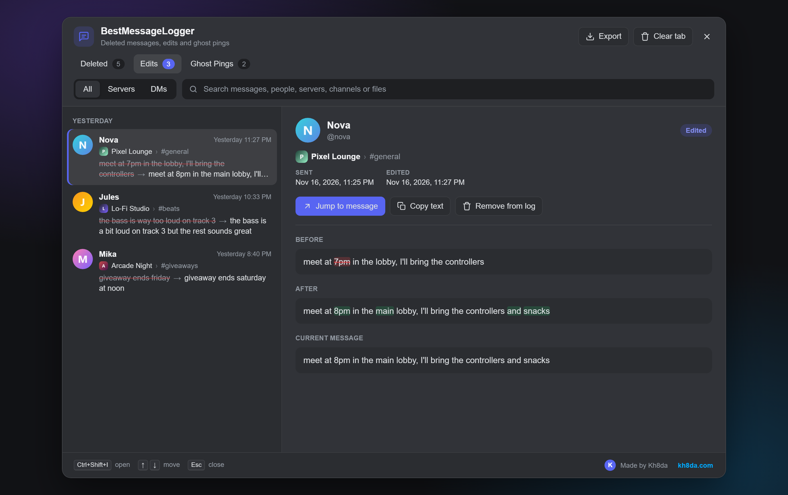
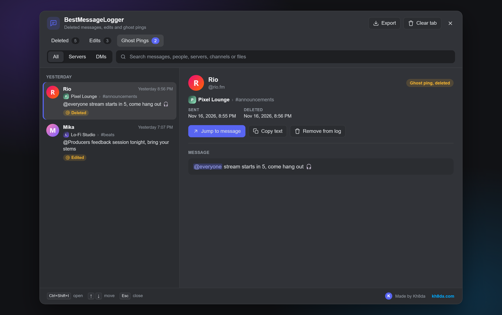
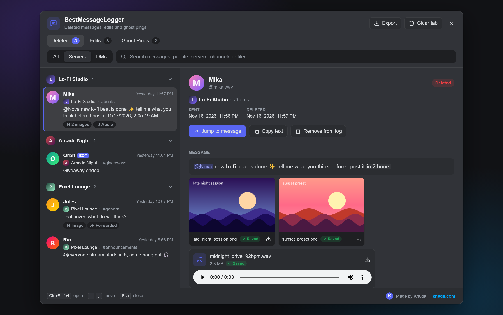
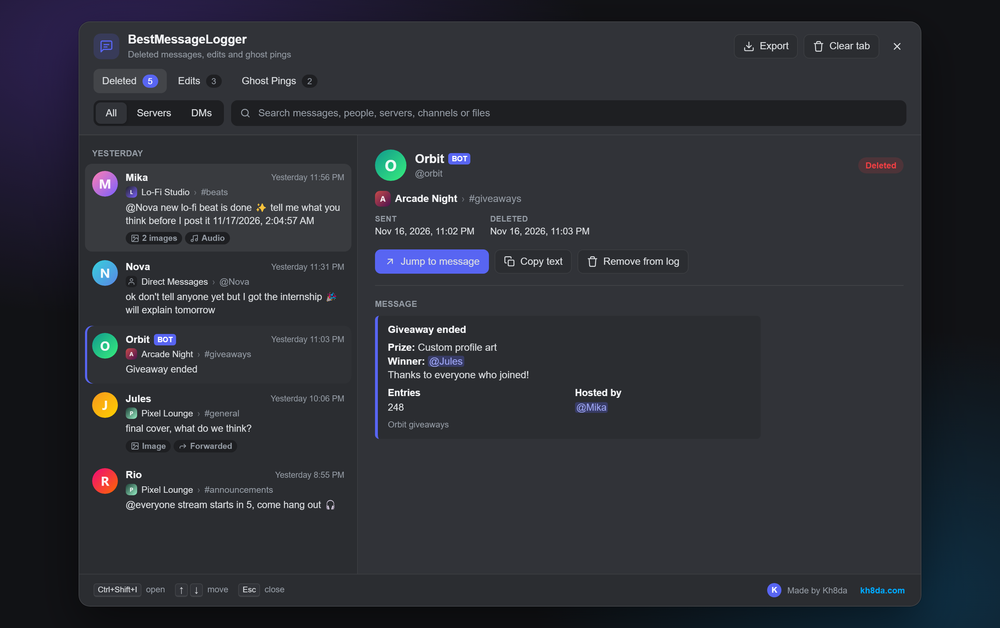
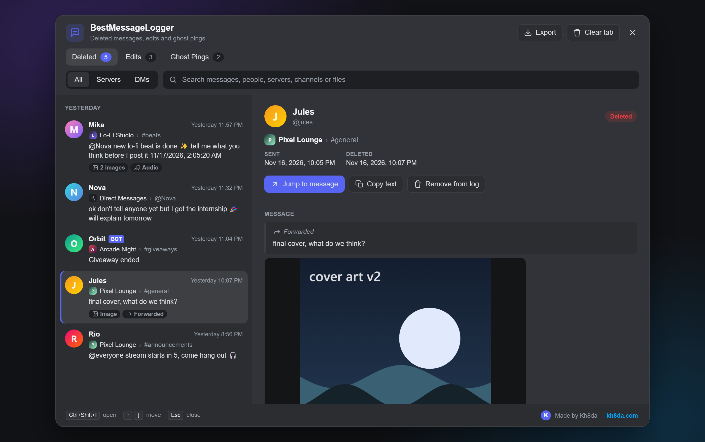
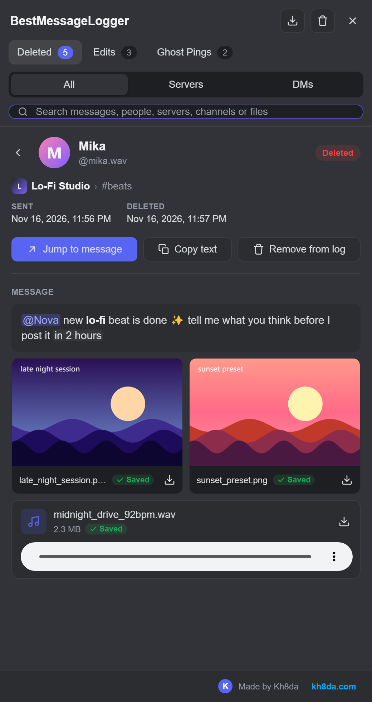

<div align="center">

# BestMessageLogger

### See deleted messages, edit history and ghost pings on Discord

A message logger plugin for [Vencord](https://vencord.dev) that keeps deleted and edited Discord messages, saves their images, videos and audio, and gives you a fast, searchable log menu.

[](https://vencord.dev)
[](LICENSE)
[](https://github.com/Kh8da/BestMessageLogger/stargazers)
[](https://kh8da.com)



[Features](#features) · [Install](#install) · [How to use](#how-to-use) · [Settings](#settings) · [FAQ](#faq) · [Privacy](#privacy)

</div>

---

## Why BestMessageLogger

Vencord's built-in MessageLogger forgets everything when you restart Discord, and deleted pictures stop loading once Discord removes them. BestMessageLogger keeps your logs on your computer, saves the media of deleted messages, and puts everything in one log menu you can search.

It started as my first Vencord plugin: a better version of the built-in MessageLogger.

## Features

### Deleted messages
- Deleted messages stay in chat in red, like the built-in logger.
- They **come back after you switch channels, reload or restart Discord**.
- Works with bulk deletes, replies, forwards, bot embeds, stickers, polls and new bot message layouts (components v2).

### Saved images, videos and audio
- When a message is deleted, its **attachments are saved on your computer** right away.
- Deleted images, videos, voice messages and audio files still open and play after Discord's link stops working.
- Each file shows **Saved** or **Online**, with a download button. You choose the size limit in settings.

### Edit history
- Every edit is logged with the text **before and after**, with changed words highlighted.
- Edit history shows below the message in chat, and clicking "(edited)" opens every version.
- Attachments removed by an edit are kept.

### Ghost pings
- Catches messages that pinged you and were then deleted or edited: direct mentions, **@everyone, @here and your roles**.

### Log menu
- Open it with **Ctrl+Shift+I** (you can change the hotkey).
- Tabs for **Deleted**, **Edits** and **Ghost Pings**, plus **All / Servers / DMs** filters.
- Messages look like they do in Discord: custom emojis, @mentions, roles, #channels, timestamps, markdown, spoilers and embeds.
- Profile pictures, **server names and server icons**, and channel names for every entry.
- **Search** across messages, people, servers, channels and file names.
- Jump to the message, copy its text, or remove single entries.
- Keyboard friendly: arrow keys, Esc, Ctrl+F.
- Fast with thousands of entries, matches your Discord theme (dark and light), and works in small windows.
- Export everything as JSON.

<table>
  <tr>
    <td width="50%"></td>
    <td width="50%"></td>
  </tr>
  <tr>
    <td align="center"><b>Edit history</b> with changed words highlighted</td>
    <td align="center"><b>Ghost pings</b> from mentions, @everyone and roles</td>
  </tr>
  <tr>
    <td width="50%"></td>
    <td width="50%"></td>
  </tr>
  <tr>
    <td align="center"><b>Grouped by server</b> with names and icons</td>
    <td align="center"><b>Bot embeds</b> shown like in Discord</td>
  </tr>
  <tr>
    <td width="50%"></td>
    <td width="50%" align="center"></td>
  </tr>
  <tr>
    <td align="center"><b>Forwarded messages</b> and their media</td>
    <td align="center"><b>Small windows</b> get a one-column layout</td>
  </tr>
</table>

## Install

BestMessageLogger is a Vencord **user plugin**, so it needs a Vencord dev install (built from source). It takes about five minutes.

**You need:** [Git](https://git-scm.com/downloads), [Node.js](https://nodejs.org) 18 or newer, and pnpm (`npm install -g pnpm`).

1. Get Vencord's source code:

   ```bash
   git clone https://github.com/Vendicated/Vencord.git
   cd Vencord
   pnpm install --frozen-lockfile
   ```

2. Add BestMessageLogger to the user plugins folder:

   ```bash
   git clone https://github.com/Kh8da/BestMessageLogger.git src/userplugins/BestMessageLogger
   ```

3. Build Vencord and install it into Discord:

   ```bash
   pnpm build
   pnpm inject
   ```

   The installer asks which Discord to patch (Stable, PTB or Canary).

4. Restart Discord. Open **User Settings → Vencord → Plugins**, turn **off** the built-in `MessageLogger`, and turn **on** `BestMessageLogger`.

The full guide is in Vencord's docs: [Installing custom plugins](https://docs.vencord.dev/installing/custom-plugins/).

### Updating

```bash
cd Vencord
git pull
pnpm install --frozen-lockfile
git -C src/userplugins/BestMessageLogger pull
pnpm build
```

Then restart Discord (or press Ctrl+R).

## How to use

| Action | How |
| --- | --- |
| Open the log menu | **Ctrl+Shift+I**, or right-click a logged message → **Open in Message Log** |
| Move between entries | **↑ / ↓** |
| Search | Type in the search box, or press **Ctrl+F** |
| Go to the original message | **Jump to message** |
| Close | **Esc** |
| Hide a deleted message in chat | Right-click it → **Clear Message History** (it stays in the log menu) |
| Clear a whole channel | Right-click the channel → **Clear Message Log** |

## Settings

| Setting | What it does | Default |
| --- | --- | --- |
| Delete style | Red text or red background for deleted messages | Red text |
| Log deletes | Keep deleted messages in chat and log them | On |
| Restore deleted in chat | Show logged deleted messages again after a reload or restart | On |
| Collapse deleted | Collapse deleted messages like blocked ones | Off |
| Log edits | Track edits | On |
| Log deleted attachments | Keep attachments removed by an edit | On |
| Inline edits | Show edit history below messages in chat | On |
| Log ghost pings | Track deleted or edited messages that pinged you | On |
| Save media | Save images, videos, audio and files of deleted messages | On |
| Max media size | Largest single file to save, in MB | 25 |
| Ignore bots / yourself | Skip messages from bots or from you | Off |
| Ignore users, channels, servers | Comma-separated IDs to skip | Empty |
| Saved limit | Most entries kept per tab | 1000 |
| Retention | Remove entries older than this many days | 30 |
| Hotkey | Shortcut for the log menu | Ctrl+Shift+I |

## FAQ

<details>
<summary><b>How do I see deleted messages on Discord?</b></summary>

Discord can't show deleted messages on its own. With BestMessageLogger installed through Vencord, deleted messages stay in chat in red, and every deleted message is listed in the log menu (Ctrl+Shift+I), with its images, videos and audio.
</details>

<details>
<summary><b>Can I see messages that were deleted before I installed it?</b></summary>

No. A message is logged only if your Discord received it while the plugin was running. Nothing can recover messages that were deleted earlier.
</details>

<details>
<summary><b>Can other people tell that I'm logging messages?</b></summary>

No. Everything happens inside your own Discord app. The plugin sends nothing to Discord or anyone else.
</details>

<details>
<summary><b>Why do deleted images still work?</b></summary>

When a message is deleted, the plugin immediately downloads its attachments from Discord and stores them on your computer. Discord's own links usually stop working a little later.
</details>

<details>
<summary><b>Does it work with BetterDiscord, Vesktop or the Vencord installer?</b></summary>

It's made for Vencord and works with any Vencord build from source, including Vesktop when you point it at your own build. The regular Vencord installer only ships the built-in plugins, so you need the from-source install described above. It doesn't work with BetterDiscord.
</details>

<details>
<summary><b>Can I use it together with the built-in MessageLogger?</b></summary>

No. Both change the same parts of Discord. Turn the built-in `MessageLogger` off; BestMessageLogger does everything it does.
</details>

<details>
<summary><b>Is this allowed by Discord?</b></summary>

Client mods like Vencord are against Discord's Terms of Service, so use them at your own risk. There are no known cases of people being banned just for using a client mod, but there's no guarantee.
</details>

<details>
<summary><b>Ctrl+Shift+I opens DevTools instead</b></summary>

Pick a different hotkey in the plugin settings, for example `Ctrl+Shift+L`.
</details>

## Privacy

- Logs and saved media stay **on your computer**, in Discord's local storage (IndexedDB).
- Nothing is uploaded anywhere. No analytics, no tracking.
- Media is only downloaded from Discord's own servers, never straight from third party sites.
- Clear a tab, a single entry or everything at any time. Old entries are removed automatically after the retention period.

## Credits

- Built on Vencord's [MessageLogger](https://github.com/Vendicated/Vencord/tree/main/src/plugins/messageLogger) by Vendicated and contributors.
- Made by **Kh8da**. More of my work: [kh8da.com](https://kh8da.com)

If BestMessageLogger helps you, a ⭐ on GitHub helps other people find it.

## License

[GPL-3.0](LICENSE), the same license as Vencord.
